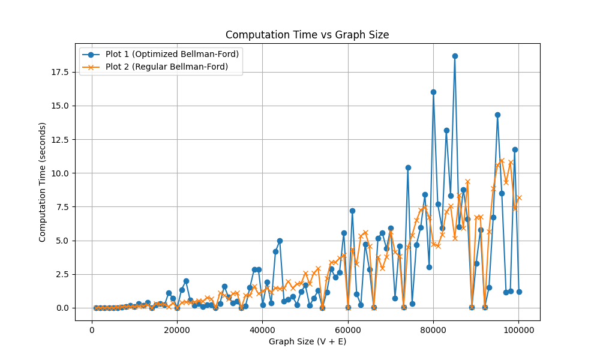

# Shortest Path Algorithms — Research & Verified Implementations

A collection of shortest-path algorithms for directed graphs with **signed integer weights**, featuring verified implementations, exhaustive tests, and reproducible benchmarks. The project progresses from early exploratory experiments to formally argued, sanitizer-verified solvers.



---

## Highlights

- **Exact 128-bit integer arithmetic** — no floating-point tolerance, overflow throws
- **Negative-cycle certification** — returns an original-edge witness with a checked negative sum
- **Five solver variants** — portfolio hybrid, SCC-aware signed-core, structural branch-core, adaptive core, and a competitive portfolio experiment
- **32,000 seeded random graphs**, 4,096 exhaustive graphs, and 500 subdivided cores checked against a Floyd-Warshall oracle under AddressSanitizer / UBSan

---

## Project Structure

```
.
├── include/                        # Header-only algorithm libraries
│   ├── shortest_paths.hpp          # Portfolio solver: DAG / Dijkstra / bounded-heap / Bellman-Ford
│   ├── signed_core.hpp             # SCC decomposition + local potentials & negative-edge phases
│   ├── branch_core.hpp             # Structural compression: forced-path contraction on SCCs
│   ├── adaptive_core.hpp           # Two-pass probe with BranchCore fallback
│   └── competitive_paths.hpp       # DAG specialization + four bounded engines with doubling budgets
│
├── src/                            # Interactive demo programs (stdin → stdout)
│   ├── shortest_paths_demo.cpp
│   ├── signed_core_demo.cpp
│   └── branch_core_demo.cpp
│
├── tests/                          # Regression & fuzz test suites
│   ├── shortest_paths_test.cpp     # 12,000 seeded random graphs × 3 solver configs
│   └── signed_core_test.cpp        # 4,096 exhaustive + 20,000 random + 500 subdivided cores
│
├── benchmarks/                     # Reproducible, answer-checked benchmarks
│   ├── shortest_paths_benchmark.cpp
│   ├── signed_core_benchmark.cpp
│   └── competitive_paths_benchmark.cpp # Broader comparison with fresh-seed holdout
│
├── legacy/                         # Historical experiments (see docs/ALGORITHM.md for caveats)
│   ├── Main.cpp                    # Original heap + visit-counter approach
│   ├── ap_spfa.cpp                 # Adaptive Priority SPFA with SLF optimization
│   ├── benchmark.cpp               # Early timing comparison (BF / SPFA / AP-SPFA)
│   └── local.cpp                   # Coloring-based cycle detection experiment
│
├── data/                           # Benchmark results & plot data
│   ├── verified_benchmark_results.csv
│   ├── signed_core_results.csv
│   ├── adaptive_trial_results.csv  # Seven-method adaptive comparison
│   ├── competitive_trial_results.csv
│   ├── competitive_holdout_results.csv
│   ├── competitive_trial_initial_results.csv # Development run before dispatch improvements
│   ├── benchmark_results.txt
│   └── plot1–4.txt
│
├── docs/                           # Research documentation & figures
│   ├── ALGORITHM.md                # Findings, counterexample, correctness proof, prior-art review
│   ├── SIGNED_CORE.md              # BranchCore proof, structural bound, novelty audit
│   ├── SESSION_NOTES.md            # Research session record, outcomes, and open questions
│   ├── ADAPTIVE_TRIAL.md
│   ├── COMPETITIVE_TRIAL.md        # Finite-portfolio guarantee, research update, and honest results
│   ├── Figure_1.png
│   └── heap_VS_queue.png
│
├── scripts/
│   ├── plotting.py                 # Matplotlib visualization for legacy benchmark data
│   └── summarize_competitive.py    # Equal-family geometric scores and worst slowdowns
│
├── Makefile                        # Build everything with one command
├── CONTRIBUTING.md
└── README.md
```

---

## Algorithms Implemented

### 1. Portfolio Solver (`shortest_paths.hpp`)

A deterministic combination of established methods:

| Graph Class | Method | Time Bound | Space |
|---|---|---|---|
| DAG | Topological-order relaxation | O(n + m) | O(n + m) |
| Nonnegative cyclic | Binary-heap Dijkstra | O(n + m log(m + 1)) | O(n + m) |
| Mixed-weight heap phase only | Bounded heap + periodic cycle checks | O((n + m) log(n + m)) | O(n + m) |
| Full mixed-weight solve, including fallback | Bounded heap followed by Bellman-Ford if needed | O(nm + (n + m) log(n + m)) | O(n + m) |

### 2. Signed-Core Solver (`signed_core.hpp`)

SCC decomposition with per-component optimization:
- **Iterative Kosaraju** for strongly connected components
- **Tree-potential reweighting** to reduce negative-edge tails
- **Dijkstra closure + negative-edge phases** bounded by remaining negative tails
- **Historical walk recovery** for negative-cycle certification

### 3. BranchCore Solver (`branch_core.hpp`)

Structural compression eliminating forced continuations:
- Contracts vertices with exactly one internal outgoing edge
- Runs Bellman-Ford on the **compressed branching core** only
- **Total structural bound**: O(n + m + Σ k_C · t_C), where k_C and t_C count retained core vertices and edges in reachable SCC C (a ring retains one anchor and one edge)
- Linear time when internal excess per SCC is constant

BranchCore is an experimental composition with a documented correctness
argument. Its scientific novelty is unverified; its general worst-case bound
remains O(n + m + nm), and it does not win every benchmark.

### 4. Adaptive Core (`adaptive_core.hpp`)

An experimental two-pass Bellman-Ford probe returns early when no label changes;
otherwise it runs BranchCore. See [the trial report](docs/ADAPTIVE_TRIAL.md)
for its guarantees and measured wins and losses.

### 5. Competitive Portfolio (`competitive_paths.hpp`)

Returns immediately on DAGs; otherwise races bounded Bellman-Ford, FIFO,
indexed-heap, and BranchCore attempts under budgets that double. It returns
exact distances or a verified negative-cycle witness. Its bound is
`O(n + m + min_i q_i)`, where `q_i` is each **included engine's metered work**;
space is `O(n + m)`. This is a guarantee relative to four specific engines.

The [trial report](docs/COMPETITIVE_TRIAL.md) gives the proof, computational
model, current research, and development/holdout measurements. The experiment
does not establish a universally best algorithm or a new asymptotic record.

---

## Getting Started

### Prerequisites

- **C++17** compiler (Clang ≥ 10 or GCC ≥ 8)
- **Make** (optional, for the Makefile)
- **Python 3 + Matplotlib** (optional, for plotting)

### Build

```bash
# Build demos and tests
make all

# Or build individual targets
make demos
make tests
make benchmarks
```

### Run Tests

```bash
make run-tests
```

Expected output:
```
=== Shortest Paths Tests ===
PASS: regressions and 12000 seeded random graphs; three solver configurations checked against Floyd-Warshall

=== Signed Core + Branch Core Tests ===
PASS: regressions, 4096 exhaustive graphs (all sources), 20000 seeded random graphs; nine configurations vs Floyd-Warshall; 500 random subdivided cores; 2000 bounded-engine and metamorphic trials
```

### Run Demos

Input format: `n m source`, then `m` lines of `from to weight` (zero-based vertices).

```bash
# Detect a negative cycle
printf '3 3 0\n0 1 1\n1 2 -5\n2 0 2\n' | build/shortest_paths_demo

# Find shortest distances in a DAG
printf '4 6 0\n0 1 -10\n0 2 -20\n0 3 -25\n1 2 -20\n1 3 -22\n2 3 -10\n' | build/shortest_paths_demo
```

### Run Benchmarks

```bash
make run-benchmarks

# Save results to CSV
build/shortest_paths_benchmark > data/verified_benchmark_results.csv
build/signed_core_benchmark > data/signed_core_results.csv
build/competitive_paths_benchmark > data/competitive_trial_results.csv
build/competitive_paths_benchmark --holdout > data/competitive_holdout_results.csv
python3 scripts/summarize_competitive.py data/competitive_holdout_results.csv
```

---

## Key Insight: Why Visit Counters Fail

The legacy experiments (`Main.cpp`, `ap_spfa.cpp`) used relaxation counts to detect negative cycles — if a vertex is relaxed ≥ V times, report a cycle. This is **incorrect**.

**Counterexample** (documented in `docs/ALGORITHM.md`):

```
Source 0; 4 vertices; DAG edges:
0→1: -10,  0→2: -20,  0→3: -25
1→2: -20,  1→3: -22,  2→3: -10
```

Vertex 3 improves **4 times** through different paths, but there is **no cycle** — it's a DAG. The correct shortest distance to vertex 3 is −40. The verified implementation uses predecessor-graph inspection with explicit weight summation instead.

---

## Documentation

- [**SESSION_NOTES.md**](docs/SESSION_NOTES.md) — Session record connecting the original hypothesis, implemented candidates, results, and open research questions
- [**ADAPTIVE_TRIAL.md**](docs/ADAPTIVE_TRIAL.md) — Two-pass adaptive experiment and measured results
- [**COMPETITIVE_TRIAL.md**](docs/COMPETITIVE_TRIAL.md) — Four-engine restart portfolio, precise guarantee, research update, and broader evaluation
- [**ALGORITHM.md**](docs/ALGORITHM.md) — Detailed findings, counterexample proof, correctness argument, complexity analysis, and prior-art survey
- [**SIGNED_CORE.md**](docs/SIGNED_CORE.md) — BranchCore structural bound derivation, correctness proof, novelty audit against 8 research papers, and benchmark analysis

---

## Build Environments Tested

| Compiler | Platform | Status |
|---|---|---|
| Apple Clang 21.0.0 | macOS arm64 | ✅ Passing |

Tests run with `-fsanitize=address,undefined` and `-Werror`.

---

## Contributing

See [CONTRIBUTING.md](CONTRIBUTING.md) for guidelines.

---

## License

This project is provided for educational and research purposes. See individual source files for authorship.
